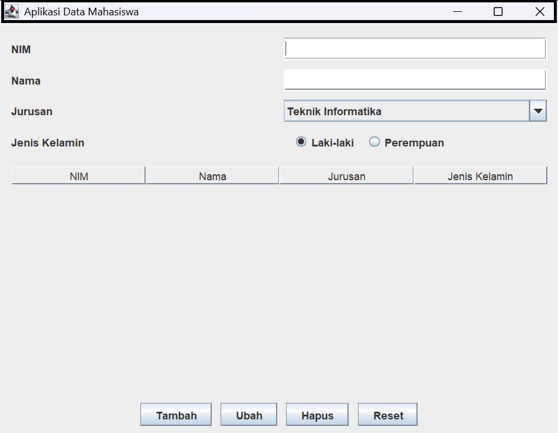
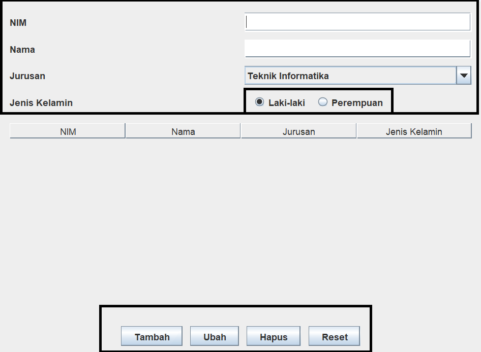
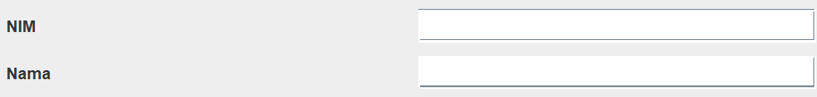
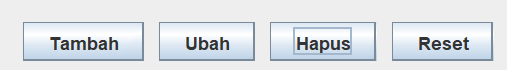
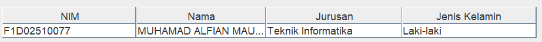
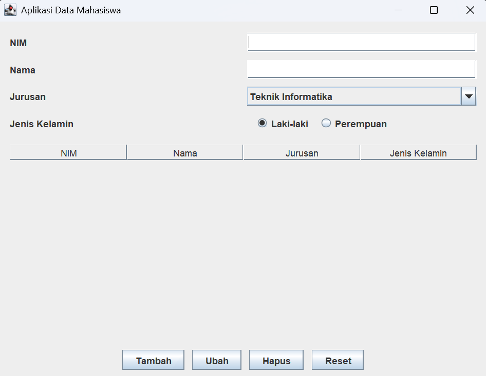
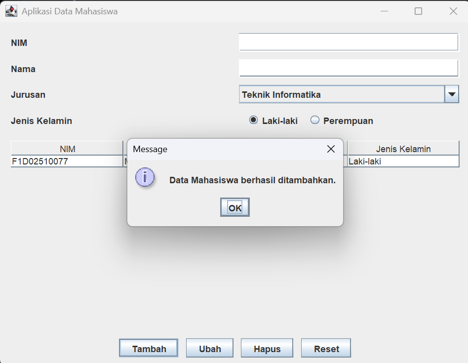
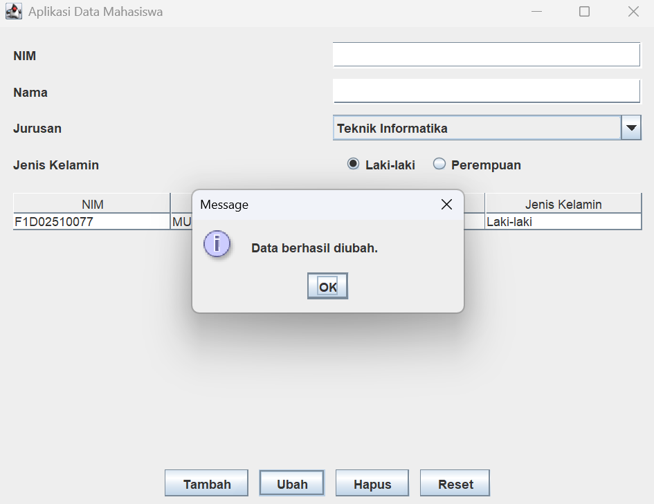

# Aplikasi Data Mahasiswa (GUI Java Swing)

Aplikasi desktop sederhana untuk mengelola data mahasiswa (tambah, ubah, hapus, dan tampil dalam tabel), dibuat dengan **Java Swing** sebagai tugas materi GUI.

## Identitas

| Keterangan    | Isi                         |
|---------------|-----------------------------|
| Nama          | Muhamad Alfian Maulana      |
| NIM           | `[F1D02510077]`            |
| Kelas         | `[INFORMATIKA 3B]`               |

## Daftar Isi

- [Deskripsi](#deskripsi)
- [Fitur](#fitur)
- [Teknologi](#teknologi)
- [Struktur File](#struktur-file)
- [Penjelasan Class](#penjelasan-class)
- [5 Komponen Utama GUI](#5-komponen-utama-gui)
- [Cara Menjalankan](#cara-menjalankan)
- [Screenshot](#screenshot)
- [Konsep yang Diterapkan](#konsep-yang-diterapkan)
- [Batasan](#batasan)

## Deskripsi

Program ini menampilkan antarmuka grafis (GUI) untuk mencatat data mahasiswa. Pengguna mengisi form (NIM, Nama, Jurusan, Jenis Kelamin), lalu data ditampilkan pada tabel. Data yang sudah ada dapat dipilih dari tabel untuk diubah atau dihapus.

## Fitur

- **Tambah data**: menyimpan data mahasiswa baru ke dalam daftar.
- **Ubah data**: memperbarui data yang dipilih dari tabel (NIM dikunci dan tidak dapat diubah).
- **Hapus data**: menghapus data yang dipilih, dengan dialog konfirmasi.
- **Reset form**: mengosongkan isian dan membatalkan pilihan baris.
- **Validasi input**: NIM dan Nama tidak boleh kosong.
- **Cek NIM ganda**: NIM yang sudah terdaftar tidak dapat ditambahkan lagi.
- **Isi form otomatis**: klik baris pada tabel untuk menampilkan datanya di form.

## Teknologi

- Bahasa pemrograman: Java
- Library GUI: Swing (`javax.swing`) dan AWT (`java.awt`)
- Penyimpanan data: `ArrayList` (sementara, hilang saat program ditutup)

## Struktur File

```
Tugas-GUI/
├── Orang.java            # abstract class
├── Mahasiswa.java        # turunan dari Orang
├── Operasi.java          # interface
├── DataMahasiswa.java    # implementasi interface Operasi (penyimpan data)
├── MainFrame.java        # tampilan GUI dan penanganan event
├── Main.java             # titik awal program
├── screenshot/
│   ├── tampilan-awal.png
│   ├── tambah-data.png
│   ├── ubah-hapus-data.png
│   ├── komponen-jframe.png
│   ├── komponen-jpanel.png
│   ├── komponen-jtextfield.png
│   ├── komponen-jbutton.png
│   └── komponen-jtable.png
└── README.md
```

## Penjelasan Class

| File | Jenis | Fungsi |
|------|-------|--------|
| `Orang.java` | Abstract class | Kerangka dasar berisi atribut `nama` dan method abstract `getPeran()`. |
| `Mahasiswa.java` | Class (extends `Orang`) | Menyimpan NIM, jurusan, dan jenis kelamin; mengisi method `getPeran()`. |
| `Operasi.java` | Interface | Kontrak operasi data: `tambah`, `ubah`, `hapus`. |
| `DataMahasiswa.java` | Class (implements `Operasi`) | Menyimpan objek `Mahasiswa` dalam `ArrayList` dan mengecek NIM ganda. |
| `MainFrame.java` | Class (extends `JFrame`, implements `ActionListener`) | Menyusun tampilan dan menangani klik tombol serta klik tabel. |
| `Main.java` | Class | Membuat dan menampilkan jendela utama. |

### Susunan Komponen GUI

```
JFrame (MainFrame)                  BorderLayout
├── JPanel form          [NORTH]    GridLayout 4 x 2
│   ├── JLabel + JTextField         (NIM, Nama)
│   ├── JLabel + JComboBox          (Jurusan)
│   └── JPanel + 2 JRadioButton     (Jenis Kelamin)
├── JScrollPane          [CENTER]
│   └── JTable                      (DefaultTableModel)
└── JPanel tombol        [SOUTH]    FlowLayout
    └── 4 JButton                   (Tambah, Ubah, Hapus, Reset)
```

## 5 Komponen Utama GUI

Berikut lima komponen utama yang digunakan dalam program ini. Semuanya berasal dari library **Swing** (`javax.swing`).

### Ringkasan

| No | Komponen | Jenis | Package | Induk langsung | Fungsi di program |
|----|----------|-------|---------|----------------|-------------------|
| 1 | `JFrame` | Class | `javax.swing` | `java.awt.Frame` | Jendela utama aplikasi (top level container) |
| 2 | `JPanel` | Class | `javax.swing` | `JComponent` | Wadah untuk mengelompokkan komponen (form dan tombol) |
| 3 | `JTextField` | Class | `javax.swing` | `JTextComponent` | Kotak isian NIM dan Nama |
| 4 | `JButton` | Class | `javax.swing` | `AbstractButton` | Tombol Tambah, Ubah, Hapus, dan Reset |
| 5 | `JTable` | Class | `javax.swing` | `JComponent` | Menampilkan daftar mahasiswa dalam bentuk tabel |

Interface pendukung yang ikut digunakan:

| Interface | Package | Dipakai untuk |
|-----------|---------|---------------|
| `ActionListener` | `java.awt.event` | Menangani klik tombol (`MainFrame implements ActionListener`) |
| `ListSelectionModel` | `javax.swing` | Mengatur mode pilih baris tabel (`SINGLE_SELECTION`) |

### 1. JFrame

Jendela utama aplikasi. Komponen lain diletakkan di dalamnya. Pada program ini `MainFrame` mewarisi `JFrame` (`extends JFrame`).

Method yang digunakan:

| Method | Fungsi |
|--------|--------|
| `setTitle()` | mengatur judul jendela |
| `setSize()` | mengatur ukuran jendela |
| `setDefaultCloseOperation()` | program berhenti saat jendela ditutup |
| `setLocationRelativeTo(null)` | jendela muncul di tengah layar |
| `setLayout()` | mengatur layout (`BorderLayout`) |
| `add()` | menambahkan panel ke jendela |
| `setVisible(true)` | menampilkan jendela |

```java
public class MainFrame extends JFrame implements ActionListener {
    public MainFrame() {
        setTitle("Aplikasi Data Mahasiswa");
        setSize(650, 500);
        setDefaultCloseOperation(EXIT_ON_CLOSE);
        setLocationRelativeTo(null);
        setLayout(new BorderLayout(10, 10));
    }
}
```



### 2. JPanel

Wadah (intermediate container) untuk mengelompokkan komponen agar tata letaknya rapi. Program ini memakai panel form (atas), panel tombol (bawah), dan panel kecil untuk radio button jenis kelamin.

Method yang digunakan:

| Method | Fungsi |
|--------|--------|
| `new JPanel(layout)` | membuat panel dengan layout tertentu |
| `add()` | menambahkan komponen ke panel |
| `setBorder()` | memberi jarak tepi |

```java
JPanel panel = new JPanel(new GridLayout(4, 2, 10, 10));
panel.add(new JLabel("NIM"));
panel.add(txtNim);
```



### 3. JTextField

Kotak isian satu baris untuk mengetik teks. Dipakai untuk NIM dan Nama.

Method yang digunakan:

| Method | Fungsi |
|--------|--------|
| `getText()` | mengambil teks yang diketik |
| `setText()` | mengisi atau mengosongkan teks |
| `setEnabled()` | mengunci atau membuka kotak isian (NIM dikunci saat mode ubah) |

```java
txtNim = new JTextField();
String nim = txtNim.getText().trim();
txtNim.setText("");
```



### 4. JButton

Tombol yang dapat diklik. Klik ditangani oleh interface `ActionListener` yang diimplementasikan `MainFrame`, lalu dijalankan method `actionPerformed()`.

Method yang digunakan:

| Method | Fungsi |
|--------|--------|
| `new JButton("teks")` | membuat tombol |
| `addActionListener(this)` | mendaftarkan penerima klik |
| `e.getSource()` | mengetahui tombol mana yang diklik |

```java
btnTambah.addActionListener(this);

@Override
public void actionPerformed(ActionEvent e) {
    Object sumber = e.getSource();
    if (sumber == btnTambah) {
        tambahData();
    }
}
```



### 5. JTable

Komponen untuk menampilkan data dalam bentuk tabel. Isi tabel diatur oleh `DefaultTableModel`, dan tabel dibungkus `JScrollPane` agar judul kolom tampil dan dapat di-scroll.

Method yang digunakan:

| Method | Fungsi |
|--------|--------|
| `new JTable(model)` | membuat tabel dari model |
| `setSelectionMode(ListSelectionModel.SINGLE_SELECTION)` | hanya satu baris yang bisa dipilih |
| `getSelectedRow()` | mengambil nomor baris yang dipilih (`-1` jika tidak ada) |
| `modelTabel.addRow()` | menambahkan satu baris |
| `modelTabel.setRowCount(0)` | mengosongkan tabel |

```java
modelTabel = new DefaultTableModel(
    new String[]{"NIM", "Nama", "Jurusan", "Jenis Kelamin"}, 0);
tabel = new JTable(modelTabel);
JScrollPane scroll = new JScrollPane(tabel);
```



## Cara Menjalankan

### Prasyarat

- JDK (Java Development Kit) sudah terpasang. Cek dengan:

  ```
  java -version
  javac -version
  ```

### Langkah

1. Pastikan semua file `.java` berada dalam satu folder.
2. Buka terminal atau command prompt di folder tersebut.
3. Compile semua file:

   ```
   javac *.java
   ```

4. Jalankan program:

   ```
   java Main
   ```

Alternatif: buka folder di IDE (NetBeans, IntelliJ IDEA, Eclipse, atau VS Code), lalu jalankan `Main.java`.

## Screenshot

### Tampilan awal



### Menambah data



### Mengubah dan menghapus data



## Konsep yang Diterapkan

- **Abstract class**: `Orang` dengan method abstract `getPeran()`.
- **Inheritance**: `Mahasiswa extends Orang`.
- **Interface**: `Operasi` yang diimplementasikan oleh `DataMahasiswa`.
- **Collection**: `ArrayList` untuk menyimpan data.
- **GUI Swing**: `JFrame`, `JPanel`, `JLabel`, `JTextField`, `JComboBox`, `JRadioButton`, `JButton`, `JTable`, `JScrollPane`, dan `JOptionPane`.
- **Layout manager**: `BorderLayout`, `GridLayout`, dan `FlowLayout`.
- **Event handling**: `ActionListener` untuk tombol dan `MouseAdapter` untuk klik tabel.

## Batasan

- Data hanya tersimpan di memori (`ArrayList`), sehingga **hilang saat program ditutup**.
- Belum menggunakan database maupun penyimpanan ke file.
- Belum ada fitur pencarian dan pengurutan data.

## Penulis

**Muhamad Alfian Maulana**
NIM: `[F1D02510077]`
